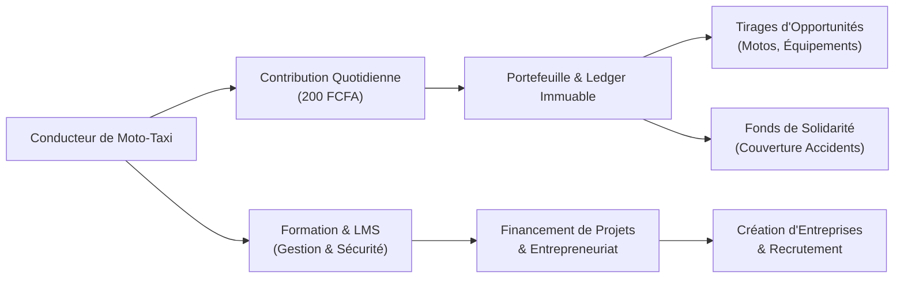
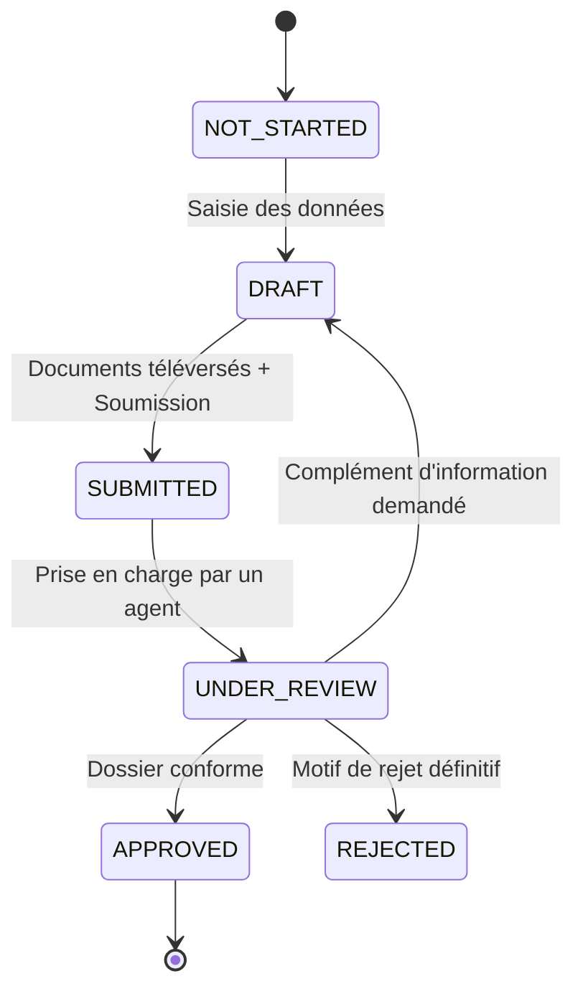
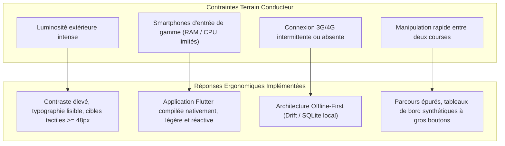

# BENSKIN IMPACT — Étude Complète du Projet

> **« 200 FCFA aujourd'hui. Une opportunité demain. »**  
> *Plateforme numérique d'inclusion financière, de protection solidaire et de transition socio-économique pour les conducteurs de motos-taxis.*

---

## Sommaire

1. [Contexte et Justification du Projet](#1-contexte-et-justification-du-projet)
2. [Vision et Objectifs Stratégiques](#2-vision-et-objectifs-stratégiques)
3. [Acteurs et Parties Prenantes](#3-acteurs-et-parties-prenantes)
4. [Étude Fonctionnelle Détaillée](#4-étude-fonctionnelle-détaillée)
   - 4.1 Authentification, Sécurité et Onboarding
   - 4.2 Vérification d'Identité (KYC — Know Your Customer)
   - 4.3 Portefeuille Numérique (Wallet) et Flux Financiers
   - 4.4 Moteur Comptable Immuable (Ledger en Partie Double)
   - 4.5 Contributions Programmées (Micro-Épargne Quotidienne)
   - 4.6 Moteur de Tirages Auditables et Attribution d'Opportunités
   - 4.7 Académie et Formation Entrepreneuriale (LMS)
   - 4.8 Projets et Entrepreneuriat
   - 4.9 Écosystème Entreprises et Recrutement
   - 4.10 Fonds de Solidarité Volontaire et Gestion des Accidents
   - 4.11 Support, FAQ et Communication
   - 4.12 Console d'Administration et Back-Office (Staff)
5. [Principes d'Expérience Utilisateur (UX/UI) & Mode Hors Ligne](#5-principes-dexpérience-utilisateur-uxui--mode-hors-ligne)
6. [Architecture Technique et Choix Technologiques](#6-architecture-technique-et-choix-technologiques)
7. [Sécurité, Intégrité et Conformité](#7-sécurité-intégrité-et-conformité)
8. [État Actuel de l'Implémentation et Roadmap](#8-état-actuel-de-limplémentation-et-roadmap)
9. [Facteurs Clés de Succès et Analyse des Risques](#9-facteurs-clés-de-succès-et-analyse-des-risques)

---

## 1. Contexte et Justification du Projet

Dans les grandes métropoles d'Afrique subsaharienne (notamment au Cameroun avec les *benskins* à Douala, Yaoundé, etc.), les conducteurs de motos-taxis représentent un rouleau compresseur de la mobilité urbaine quotidienne et un bassin d'emploi massif pour la jeunesse.

Cependant, cette corporation fait face à une précarité structurelle multidimensionnelle :
- **Exclusion bancaire classique :** Les conducteurs opèrent dans une économie 100 % liquide (*cash*), sans historique de crédit, sans accès aux prêts bancaires traditionnels ni instruments d'épargne formels.
- **Vulnérabilité extrême face aux aléas de la vie :** Les accidents de la circulation sont fréquents et constituent une menace d'effondrement économique immédiat pour le conducteur et sa famille. Les assurances obligatoires sont souvent perçues comme distantes, lentes ou inaccessibles.
- **Absence de trajectoire d'ascension sociale :** Le métier de moto-taximan est trop souvent une voie sans issue. Sans formation de gestion, sans capital d'amorçage ni opportunités d'embauche, il est très difficile de basculer vers des activités plus pérennes (commerce, logistique formelle, artisanat, agriculture).
- **Tontines traditionnelles informelles :** Bien que populaires, les tontines physiques présentent des risques élevés : manque de transparence, risques de vol de caisse, litiges relationnels, absence de traçabilité.

**BENSKIN IMPACT** naît pour répondre à ce défi en combinant le meilleur de la technologie mobile, de la finance décentralisée/communautaire transparente, de l'éducation numérique et de la solidarité africaine.

---

## 2. Vision et Objectifs Stratégiques

### 2.1 La Vision
BENSKIN IMPACT transforme une micro-dépense quotidienne de **200 FCFA** en un levier d'émancipation personnelle et collective. Le projet refuse le modèle de la « charité passive » au profit d'un contrat moral d'engagement, d'apprentissage et de co-responsabilité.

### 2.2 Objectifs Quantitatifs et Qualitatifs
1. **Inclusion financière accessible :** Permettre à tout conducteur de posséder un portefeuille électronique sécurisé, alimentable par Mobile Money (Orange Money, MTN Mobile Money).
2. **Discipline de contribution quotidienne :** Structurer une habitude d'épargne/cotisation programmée de 200 FCFA/jour, adaptée aux flux de revenus quotidiens des conducteurs.
3. **Attribution équitable et transparente d'opportunités :** Réaliser des tirages au sort audités mathématiquement (motos neuves, kits d'équipements, financements de projets) sans favoritisme possible.
4. **Montée en compétences (Up-skilling) :** Former les conducteurs à l'éducation financière, à la sécurité routière, au secourisme et à la gestion d'entreprise via un LMS mobile interactif adapté à leur réalité.
5. **Incubation de projets et transition professionnelle :** Financer et accompagner la création de micro-entreprises viables portées par les membres ayant validé leur parcours de formation.
6. **Filet de sécurité communautaire :** Offrir une couverture accident solidaire, participative et volontaire, sans esprit de lucre ni coûts cachés.



---

## 3. Acteurs et Parties Prenantes

| Acteur | Rôle & Permissions | Canal d'accès |
|---|---|---|
| **Membre (Conducteur / Entrepreneur)** | Utilisateur principal : recharge son wallet, contribue, participe aux tirages, suit les formations, soumet des projets, adhère à la solidarité, postule à des offres. | Application Mobile Flutter (Android) |
| **Agent KYC / Conformité (Staff)** | Vérifie les pièces d'identité, valide les dossiers KYC, demande des compléments d'information, détecte les anomalies. | Back-Office Angular / API Admin |
| **Gestionnaire des Risques & Solidarité** | Instruit les déclarations d'accidents, audite les devis médicaux/mécaniques, valide le déblocage des aides du fonds. | Back-Office Angular / API Admin |
| **Comité Projets & Formation (LMS)** | Crée et gère les modules pédagogiques, évalue la viabilité des business plans des membres, approuve les financements d'amorçage. | Back-Office Angular / API Admin |
| **Superviseur Financier / Comptable** | Suit l'état du ledger, surveille les réconciliations de trésorerie Mobile Money, valide les contre-passations exceptionnelles. | Back-Office Angular / API Admin |
| **Administrateur Système (SuperAdmin)** | Paramètre les variables globales (taux, seuils, versions minimales mobiles), gère les accès et rôles Staff, audite les logs techniques. | Back-Office Angular / API Admin |

---

## 4. Étude Fonctionnelle Détaillée

### 4.1 Authentification, Sécurité et Onboarding

- **Identifiant universel :** Le numéro de téléphone mobile au format international E.164 (ex. `+2376XXXXXXXX`).
- **Inscription & Vérification OTP :**
  - Code à usage unique généré cryptographiquement (6 chiffres), expédiable par SMS.
  - Stockage en base sous forme de hash HMAC sécurisé avec délai de carence (60 secondes entre deux demandes, max 5 tentatives par code, max 5 envois par heure).
- **Code PIN à 6 chiffres :**
  - Remplacement du mot de passe complexe par un code PIN adapté à l'ergonomie mobile.
  - Hachage par algorithme de référence **Argon2id** combiné à un sel et un pepper serveur immuable.
  - Rejet automatique des codes PIN triviaux (`123456`, `000000`, `111111`, dates d'anniversaire directes).
  - Protection contre les attaques par force brute : blocage automatique du compte pendant 15 minutes après 5 tentatives infructueuses.
- **Gestion des sessions :**
  - Double jeton : *Access Token* JWT à durée courte (15 minutes) et *Refresh Token* opaque à durée longue (30 jours, rotatif).
  - Détection automatique de la réutilisation de jeton révoqué (alerte sécurité immédiate et invalidation de la famille de sessions).
- **Authentification Biométrique (Empreinte Digitale) & Sécurité Matérielle :**
  - **Détection matérielle :** Vérification native de la présence et de l'enrôlement de capteurs biométriques (empreinte digitale) sur le terminal via `local_auth`.
  - **Coffre-fort local chiffré :** Conservation sécurisée des identifiants de session (numéro de téléphone, code PIN, prénom) dans le Keystore matériel Android / Secure Enclave via `flutter_secure_storage` (`BiometricCredentialStore`).
  - **Verrouillage de l'application (*App Lock*) :** Protection automatique de l'accès à l'application par biométrie lors de la réouverture ou du passage en arrière-plan.
  - **Parcours d'enrôlement fluide :** Proposition d'activation biométrique en un clic dès la première connexion réussie par code PIN, avec possibilité de bascule instantanée Empreinte ↔ PIN.
  - **Gestion autonome & Sécurité renforcée :** Écran dédié dans les paramètres de sécurité permettant d'activer ou désactiver la biométrie (nécessite la saisie de confirmation du code PIN pour toute modification).

---

### 4.2 Vérification d'Identité (KYC — Know Your Customer)

Le respect de la conformité et la prévention des fraudes sont indispensables avant toute attribution de gains ou financement de projets.



#### Règles Métier Clés du KYC :
1. **Types de pièces acceptées :** Carte Nationale d'Identité (CNI - recto/verso/selfie), Passeport biométrique (recto/selfie), Récépissé officiel de CNI valide (recto/selfie).
2. **Intégrité documentaire :** Détection du type binaire réel (Magic Bytes) pour refuser les fichiers déguisés (JPEG, PNG, PDF uniquement).
3. **Chiffrement au repos :** Tous les documents d'identité sont chiffrés sur le disque/cloud en **AES-256-GCM** avec clé serveur dédiée.
4. **Accès ultra-sécurisé :** Les agents ne visualisent les documents que via des URLs signées HMAC d'une durée de validité de 5 minutes, avec interdiction de mise en cache navigateur.
5. **Garde-fous réviseurs :**
   - Règle anti-auto-validation : un agent staff ne peut pas instruire son propre dossier.
   - Prise en charge exclusive : verrouillage du dossier pour éviter les décisions contradictoires simultanées.
   - Journalisation immuable de chaque vue et de chaque décision.

---

### 4.3 Portefeuille Numérique (Wallet) et Flux Financiers

Le portefeuille est le compte miroir du membre au sein de la plateforme :
- **Sous-comptes :**
  - **Solde disponible :** Fonds immédiatement utilisables pour les contributions, le fonds de solidarité ou le retrait.
  - **Solde réservé / bloqué :** Montants affectés à des opérations en attente (ex: contribution programmée du lendemain, garantie de projet).
- **Alimentation (Cash-in) :**
  - Interfaçage avec les agrégateurs Mobile Money locaux (MTN MoMo, Orange Money).
  - Protocole à clé d'idempotence (`Idempotency-Key`) : impossibilité de double rechargement en cas de perte de réseau au moment du paiement.
- **Historique & Traçabilité :**
  - Visualisation fluide de toutes les entrées et sorties avec statuts clairs (En attente, Validé, Rejeté).
  - Principe cardinal : **Aucun calcul financier côté client** ; les calculs et soldes sont garantis exclusivement par le backend.

---

### 4.4 Moteur Comptable Immuable (Ledger en Partie Double)

Le cœur battant de la confiance financière de BENSKIN IMPACT repose sur un livre-journal de comptabilité en partie double d'exigence bancaire.

#### Principes Fondamentaux :
1. **Équilibre Parfait (Débit = Crédit) :** Chaque mouvement d'argent implique au minimum deux écritures dont la somme des débits est strictement égale à la somme des crédits.
2. **Typologie de Comptes :**
   - `ASSET` (Actifs : comptes de trésorerie chez les opérateurs Mobile Money).
   - `LIABILITY` (Passifs : soldes dus aux membres, fonds de solidarité mutualisé).
   - `EQUITY` (Capitaux propres).
   - `REVENUE` (Produits / Commissions de plateforme).
   - `EXPENSE` (Charges d'exploitation, subventions accordées).
3. **Immutabilité Matérielle PostgreSQL :**
   - Des déclencheurs (*triggers*) PostgreSQL bloquent au niveau du moteur de données tout `UPDATE`, `DELETE` ou `TRUNCATE` sur les tables du ledger et de l'audit.
   - Tout ajustement d'erreur comptable passe obligatoirement par une opération de **contre-passation (`reverse`)**, garantissant un audit légal parfait.
4. **Zéro Flottant :** Utilisation exclusive de types de données `NUMERIC` en base et de représentations monétaires exactes pour éradiquer tout problème d'arrondi binaire.

---

### 4.5 Contributions Programmées (Micro-Épargne Quotidienne)

- **Le Tarif :** 200 FCFA par jour calendaire.
- **Plan de Contribution :**
  - Mode manuel : Le conducteur valide sa contribution quotidienne depuis son solde wallet.
  - Mode automatique : Prélèvement automatique paramétrable chaque matin à heure fixe depuis le solde disponible.
- **Calendrier Visuel :**
  - Suivi d'assiduité sous forme de calendrier mensuel interactif (jours verts = contribués, jours rouges = manqués, jours gris = futurs).
  - Statut de fidélité et assiduité conditionnant l'éligibilité aux tirages et aux financements.

---

### 4.6 Moteur de Tirages Auditables et Attribution d'Opportunités

Pour rompre définitivement avec le soupçon de manipulation ou de favoritisme fréquent dans les loteries informelles :
- **Instantané (Snapshot) des Éligibles :**
  - À la clôture de la période, l'API génère un instantané immuable de tous les membres ayant respecté les critères d'assiduité (ex. 30 jours consécutifs de contribution, KYC approuvé).
- **Engagement de Graine Cryptographique (Seed Commitment) :**
  - Un hachage de sécurité (*Commitment Hash*) est calculé et publié **avant** le tirage.
  - La révélation de la graine (*Seed*) a posteriori permet à tout observateur indépendant, auditeur ou membre, de rejouer l'algorithme mathématique (générateur pseudo-aléatoire déterministe) et de vérifier que le résultat obtenu est rigoureusement identique.
- **Attribution des Récompenses :**
  - Motos neuves prêtes à l'emploi.
  - Casques et équipements de sécurité homologués.
  - Bons de carburant et révisions mécaniques intégrales.
  - Accompagnement à l'immatriculation et au permis de conduire officiel.

---

### 4.7 Académie et Formation Entrepreneuriale (LMS)

L'objectif ultime est l'émancipation du conducteur :
- **Parcours Pédagogique Séquentiel :**
  - Progression découpée en Modules thématiques (ex. *Module 1 : Maîtrise de ses finances quotidiennes*, *Module 2 : Code de la route & Conduite préventive*, *Module 3 : Créer et gérer une micro-entreprise*).
  - Déblocage ordonné : une leçon doit être assimilée avant d'accéder à la suivante.
- **Vérification des Acquis (Quiz) :**
  - Évaluations interactives en fin de module.
  - Règle anti-triche : 5 tentatives maximum par fenêtre de 24 heures en cas d'échec pour forcer la relecture des contenus.
- **Certifications Numériques :**
  - Délivrance d'un certificat d'accomplissement avec identifiant unique et QR code vérifiable en ligne.

---

### 4.8 Projets et Entrepreneuriat

Une fois certifiés, les membres peuvent postuler au programme d'incubation :
- **Dépôt de Dossier Structuré :**
  - Description synthétique de l'activité cible (boutique, atelier de réparation, agriculture, élevage, etc.).
  - Plan de financement simplifié : montant sollicité, apport personnel éventuel, échéancier prévisionnel.
  - Téléversement des devis et pièces justificatives.
- **Instruction et Revue :**
  - Analyse par le comité projets du back-office.
  - Notation multicritère (faisabilité, rentabilité, rigueur du candidat).
  - Décaissements échelonnés par jalons pour garantir la bonne utilisation des fonds.

---

### 4.9 Écosystème Entreprises et Recrutement

- **Profils d'Entreprises Partenaires :**
  - Entreprises de livraison, coursiers urbains, flottes logistiques, concessionnaires de motos.
- **Bourse de l'Emploi Sectorielle :**
  - Publication d'offres d'emploi dédiées aux conducteurs certifiés et en règle KYC.
  - Candidatures en 1-clic via le profil membre validé.
  - Suivi en temps réel des statuts de candidature (Reçue, En cours d'examen, Retenue pour entretien, Embauchée).

---

### 4.10 Fonds de Solidarité Volontaire et Gestion des Accidents

Un des points d'excellence éthique et légale du projet :
- **Adhésion Strictement Volontaire :**
  - Aucun membre n'est prélevé sans avoir coché et validé explicitement son adhésion aux règles du fonds de solidarité (`solidarity.rules_version`).
  - Possibilité de se retirer du fonds à tout moment.
- **Délai de Carence :**
  - Une période de carence paramétrable (`waiting_days`, ex. 14 à 30 jours) s'applique après l'adhésion pour éliminer les souscriptions opportunistes post-accident.
- **Déclaration d'Accident Assistée :**
  - Formulaire mobile d'urgence : date, lieu, photos des dégâts de la moto, ordonnances ou certificats médicaux, procès-verbal de police/gendarmerie.
- **Instruction & Déblocage Solidaire :**
  - Circuit d'approbation collégial avec limitation stricte au plafond paramétré (`solidarity.max_assistance_amount`).
  - Déclenchement d'un micro-prélèvement mutualisé auprès de la communauté des adhérents uniquement lorsque le mécanisme de collecte est explicitement activé par la gouvernance.

---

### 4.11 Support, FAQ et Communication

- **Assistance intégrée :** FAQ dynamique classée par rubriques (KYC, Wallet, Contributions, Tirages, Accidents).
- **Messagerie de Support (Ticketing) :** Possibilité d'ouvrir une demande d'aide directe avec échange de messages horodatés avec les équipes support.
- **Notifications In-App :** Alertes de rappel de contribution, résultats de tirages, validations KYC et annonces communautaires.

---

### 4.12 Console d'Administration et Back-Office (Staff)

Une application web dédiée aux opérations (`apps/admin`), assurant la gouvernance et le contrôle :
- **Tableau de Bord Global :** Volume des contributions, total des membres actifs, solde global du ledger, taux de conformité KYC, alertes de risque.
- **File de Traitement KYC :** Interface de contrôle documentaire haute productivité avec loupe, rotation d'images et raccourcis de validation.
- **Audit Logs Immuables :** Moteur de recherche multicritère sur tous les événements de la plateforme (qui a fait quoi, quand, avec quelle adresse IP masquée et quel rôle).
- **Contrôle Financier & Réconciliations :** Comparaison des soldes ledger avec les comptes partenaires télécoms.

---

## 5. Principes d'Expérience Utilisateur (UX/UI) & Mode Hors Ligne

La cible (conducteurs de motos) impose des contraintes ergonomiques strictes :



### La Stratégie Hors Ligne (Offline-First) :
1. **Séparation Stricte Actions Financières vs Non-Financières :**
   - **Opérations Financières (Recharge, Prélèvement) :** Exigent obligatoirement une connexion active et la réponse formelle de l'API. Jamais d'illusion de paiement hors ligne.
   - **Opérations Non-Financières (Leçon terminée, Brouillon de projet, Déclaration d'accident, Ticket support) :** Enregistrées immédiatement en base locale SQLite (Drift).
2. **File de Synchronisation Intelligente (`SyncQueue`) :**
   - Les requêtes en attente sont rejouées dès le retour du réseau avec leur clé d'idempotence originale.
   - Stratégie de rétrogradation exponentielle (*exponential backoff*) : retentatives espacées de 5 secondes à 30 minutes en cas d'échec réseau.
3. **Indicateurs de Fraîcheur des Données :**
   - Si les données proviennent du cache local, l'application affiche explicitement la mention « *Données synchronisées le [Date/Heure]* » afin d'éviter toute méprise sur le solde.

---

## 6. Architecture Technique et Choix Technologiques

### 6.1 Matrice des Composants

| Domaine | Technologie retenue | Justification technique |
|---|---|---|
| **Structure du dépôt** | Monorepo pnpm | Partage de code, typage unifié, déploiement coordonné et cohérence des versions. |
| **API Backend** | NestJS 11 + TypeScript 5.9 | Architecture modulaire d'entreprise, injection de dépendances robuste, forte maintenabilité. |
| **ORM & Base de données** | Prisma 6 + PostgreSQL 18 | Schéma déclaratif rigoureux, typage de bout en bout, puissance des triggers relationnels d'intégrité. |
| **Persistance Locale Dev** | `embedded-postgres` | Zéro friction d'installation : tourne en local sans exiger de conteneur Docker. |
| **Application Mobile** | Flutter 3.38 + Riverpod 2 + Drift | Multiplateforme haute performance, gestion d'état réactive, base de données SQLite embarquée typée. |
| **Back-Office Web** | Angular + TypeScript | Robustesse d'entreprise, composants standalone, outillage complet pour interfaces d'administration denses. |
| **Design Tokens** | `@benskin/ui-tokens` | Bibliothèque partagée de couleurs, polices et espacements pour garantir l'identité de marque uniforme. |

### 6.2 Schéma d'Architecture Applicative

```
                               ┌────────────────────────────────────────┐
                               │       UTILISATEURS & APPAREILS         │
                               └────────────────────────────────────────┘
                                     │                            │
                     (Android / Web Mobile)                (Navigateur Web)
                                     ▼                            ▼
                      ┌────────────────────────────┐ ┌───────────────────────────┐
                      │    apps/mobile (Flutter)   │ │    apps/admin (Angular)   │
                      │  - Drift (SQLite local)    │ │  - Interface d'exploitation│
                      │  - Riverpod / Dio          │ │  - KYC & Risk Monitoring  │
                      └────────────────────────────┘ └───────────────────────────┘
                                     │                            │
                                     │ HTTPS REST / Bearer JWT    │
                                     ▼                            ▼
                      ┌──────────────────────────────────────────────────────────┐
                      │                    apps/api (NestJS)                     │
                      │ ──────────────────────────────────────────────────────── │
                      │  [Guards] Throttler -> JwtAuth -> AccessPolicy (RBAC)    │
                      │  [Common] ValidationPipe (Strict DTO) + Logging JSON    │
                      │  [Modules Métier] Auth, KYC, Wallet, Ledger, Projects... │
                      │  [Services] Storage (AES-256-GCM), LedgerService        │
                      └──────────────────────────────────────────────────────────┘
                                                    │
                                                    ▼
                      ┌──────────────────────────────────────────────────────────┐
                      │                 PostgreSQL 18 (Relationnel)              │
                      │ ──────────────────────────────────────────────────────── │
                      │  - Schéma relationnel complet (Users, KYC, Ledger...)     │
                      │  - Triggers d'immutabilité (Audit & Ledger unalterable)  │
                      │  - Contraintes d'intégrité et équilibre Débit = Crédit    │
                      └──────────────────────────────────────────────────────────┘
```

---

## 7. Sécurité, Intégrité et Conformité

Le projet applique les normes de sécurité **OWASP ASVS** (sécurité des applications web/API) et **OWASP MASVS** (sécurité des applications mobiles) :

### 7.1 Sécurité de la Couche d'Accès
- **Politique du Refus par Défaut (*Default-Deny*) :** Toute route d'API qui n'est pas annotée explicitement par `@Public()`, `@Authenticated()` ou `@RequirePermissions(...)` retourne une erreur `403 Forbidden` immédiate.
- **Protection Anti-DDoS et Rate Limiting :** Limitation stricte des requêtes par minute sur les endpoints sensibles (authentification, renvoi d'OTP, création de paiements).
- **En-têtes Sécurisés :** Intégration de Helmet, désactivation complète de `X-Powered-By`, restriction stricte des origines CORS autorisées.

### 7.2 Confidentialité et Chiffrement
- **Chiffrement des Données Sensibles au Repos :** Clé de chiffrement serveur `DOCUMENT_ENCRYPTION_KEY` utilisant le standard AES-256-GCM avec vecteur d'initialisation aléatoire pour toutes les pièces d'identité.
- **Stockage Mobile Sécurisé :** Les clés de sessions et tokens sont conservés dans le Keystore Android via `flutter_secure_storage`.
- **Anonymisation des Logs :** Aucune adresse IP en clair dans les tables d'audit (hachage par HMAC), masquage automatique des en-têtes d'autorisation, des cookies et des clés d'idempotence.

### 7.3 Conformité Réglementaire
- **Positionnement Légal Clair :** La plateforme se positionne comme un outil de gestion communautaire, d'épargne programmée et de solidarité mutuelle. Elle n'effectue pas de création monétaire et s'appuie exclusivement sur des partenaires de paiement Mobile Money dûment agréés par les autorités bancaires (BEAC / COBAC).
- **Consentements Explicites :** Conservation en base de données de l'historique complet d'acceptation des conditions générales d'utilisation (CGU) et des chartes de solidarité avec versioning précis.

---

## 8. État Actuel de l'Implémentation et Roadmap

### 8.1 Ce qui est Achevé et Fonctionnel
- **Backend API (`apps/api`) :**
  - Architecture complète des 23 modules métier.
  - Moteur de comptabilité en partie double (`LedgerService`) avec triggers d'intégrité PostgreSQL.
  - Chaîne complète de sécurité (Auth PIN, OTP, JWT rotatif, RBAC déclaratif).
  - Gestion du KYC avec chiffrement de bout en bout et outil d'administration en ligne de commande (`kyc:dev`).
  - Moteur de tirages auditables, LMS (cours, leçons, quiz) et gestion de la solidarité volontaire.
  - Tests d'intégration automatisés avec schémas de base éphémères.
- **Application Mobile (`apps/mobile`) :**
  - Architecture par fonctionnalités (*feature-first*).
  - Gestion d'état avec Riverpod, navigation via GoRouter.
  - Couche réseau résiliente Dio avec rafraîchissement transparent du jeton.
  - **Module d'authentification biométrique (Empreinte digitale) complet :**
    - Service natif `local_auth` avec messages localisés en français.
    - Stockage chiffré dans le Keystore Android (`BiometricCredentialStore`).
    - Contrôleur d'état Riverpod (`BiometricController`) avec enrôlement post-login et bascule fluide PIN ↔ Biométrie.
    - Écran de gestion de la sécurité biométrique avec confirmation par PIN.
    - Suite de tests unitaires et de widgets automatisés (`biometric_auth_test.dart`) 100 % passants.
  - **Compatibilité multi-environnement :** Support fluide des émulateurs Android, des tests physiques par câble USB (`adb reverse`) et par Wi-Fi local sans fil (`network_security_config.xml` configuré).
  - Moteur de base de données locale (Drift) et file de synchronisation hors ligne idempotente.
  - Écrans d'onboarding, authentification, dashboard, portefeuille, formation, déclarations.
- **Composants Partagés (`packages/ui-tokens`) :**
  - Palette colorimétrique fintech/mobilité, typographie, échelles d'espacements.

### 8.2 Ce qui est en Cours et Prochaines Étapes
1. **Finalisation du Back-Office Angular (`apps/admin`) :** Raccordement des écrans d'administration (Revue KYC visuelle, validation des projets et reporting financier) aux endpoints de l'API.
2. **Passage aux Prestataires de Production :**
   - Remplacement du simulateur SMS local par une passerelle SMS réelle (Twilio, Infobip ou opérateur télécom direct).
   - Intégration des APIs de production Mobile Money (MTN MoMo API, Orange Money Web Payment).
3. **Moteur Asynchrone Évolué :** Intégration de Redis et BullMQ pour la distribution des charges (génération des certificats PDF, alertes massives par notifications push, synchronisation temps réel WebSocket).
4. **Scanner Antivirus KYC :** Branchement d'un moteur d'analyse antivirale en amont de l'encryptage des fichiers.

---

## 9. Facteurs Clés de Succès et Analyse des Risques

```mermaid
quadrantChart
    title Matrice Enjeux / Risques du Projet
    x-axis Faible Impact Métier --> Fort Impact Métier
    y-axis Faible Probabilité --> Forte Probabilité
    quadrant-1 Risques Majeurs (Priorité Absolue)
    quadrant-2 Enjeux de Sécurité
    quadrant-3 Risques Opérationnels Faibles
    quadrant-4 Opportunités Stratégiques
    "Perte de Réseau Terrain": [0.85, 0.90]
    "Fraude Documentaire KYC": [0.80, 0.60]
    "Contestation des Tirages": [0.90, 0.40]
    "Défaut d'Assiduité de Cotisation": [0.70, 0.75]
    "Panne Locale de Base de Données": [0.95, 0.15]
    "Incompréhension Ergonomique Mobile": [0.75, 0.50]
```

### Recommandations Stratégiques pour le Déploiement Terrain :
1. **Campagnes Pilotes de Proximité :** Lancer le déploiement sur une première zone circonscrite (ex: une commune ou 5 stations de motos-taxis partenaires) avec des ambassadeurs de confiance.
2. **Formation par les Pairs :** Former des « conducteurs relais » capables d'expliquer le fonctionnement de l'application et de rassurer leurs collègues sur la sécurité de leurs fonds.
3. **Visibilité Totale des Preuves de Solidarité :** Lorsque le fonds de solidarité intervient pour soigner un conducteur accidenté ou réparer sa moto, communiquer de façon transparente (avec son accord) sur l'aide apportée pour consolider la confiance collective.

---

*Document généré pour le projet BENSKIN IMPACT — Synthèse d'ingénierie logicielle et d'analyse produit.*
